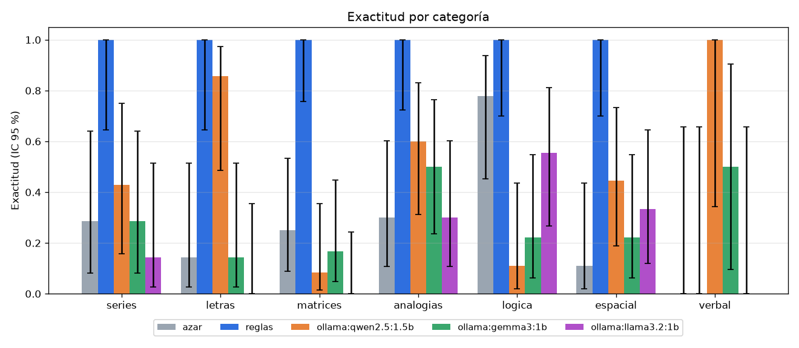
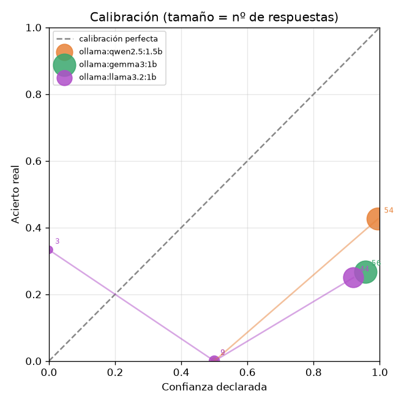
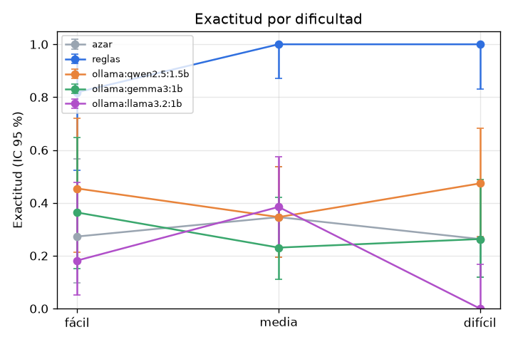

# iqtester

   

> **EN:** A bank of IQ-style reasoning questions with **guaranteed unique answers**, and a bench that measures solvers on it (random baseline, rule engine, LLM) with confidence intervals, calibration, latency and acceptance thresholds that fail CI.

### 🎮 [Pruébalo en el navegador: ¿razonas mejor que una IA?](https://rixergem-png.github.io/iqtester/)

10 preguntas y, al final, tu resultado junto al de modelos de IA **en esas mismas preguntas**.

Un banco de **preguntas tipo test de CI** (series, letras, matrices, analogías, lógica, orientación espacial y verbal) y un **banco de pruebas** para medir quién las resuelve y cuánto se puede confiar en él: el azar, un motor de reglas o un modelo de lenguaje.

```
Serie: 18, 27, 22, 30, 26, 33, 30, ?          Premisas: Todos los valkos son quelos. Ningún quelo es flime.
¿Qué número sigue?                            ¿Se cumple que «Algunos valkos no son flimes»?
A) 38  B) 36  C) 34  D) 35                    A) Sí, siempre  B) No, nunca  C) No se puede saber
```

## Qué contiene

| Pieza | Qué hace |
|---|---|
| `preguntas.py` | Genera 180 preguntas con semilla fija (30 por categoría) + 12 verbales escritas a mano. **Descarta las ambiguas**: si alguna regla conocida da otra respuesta, la pregunta no entra. Split estable dev/test (≈70/30) por hash del id |
| `reglas.py` | Motores de razonamiento: series (aritmética, geométrica, diferencias crecientes, Fibonacci, intercaladas), matrices por filas, transformaciones numéricas, **lógica por modelos** (revisa todos los "mundos posibles" que cumplen las premisas) y giros |
| `solvers.py` | `azar` (base mínima) · `reglas` (lee el enunciado y aplica los motores; si no lo entiende, **se abstiene**) · `ollama:<modelo>` (modelo local, JSON forzado por esquema, temperatura 0) · `claude` (salida estructurada: letra + confianza) · `simulado` (imita un LLM para probar el pipeline: **no son datos de ningún modelo real**) |
| `metricas.py` | Intervalo de **Wilson** al 95 %, **calibración** (ECE), percentiles de latencia. Solo librería estándar |
| `evaluar.py` | Exactitud, cobertura, precisión, ECE, p50/p95 por categoría y **por dificultad** · **umbrales** y **puerta de regresión** contra `docs/baseline.json` (código 1 si algo empeora) · análisis de errores |
| `graficos.py` | Exactitud por categoría con IC, **diagrama de calibración** y exactitud por dificultad |
| `cli.py` | `generar`, `evaluar`, `errores`, `graficos`, `web`, `jugar` |
| `docs/index.html` | El test jugable (GitHub Pages, sin dependencias) |

## Resultados (split de test, 56 preguntas · 2026-11-26)

| Solver | Exactitud (IC 95 %) | Confianza media al **acertar** / al **fallar** | ECE | Latencia p50 |
|---|---|---|---:|---:|
| Motor de reglas | **96 %** (88 %–99 %) · se abstiene en verbal | — | — | < 0,01 s |
| `qwen2.5:1.5b` | 41 % (29 %–54 %) | 0,99 / 0,97 | 0,57 | 2,9 s |
| Azar (referencia) | 30 % (20 %–43 %) · esperado 26 % | — | — | — |
| `gemma3:1b` | 27 % (17 %–40 %) | 0,95 / 0,96 | 0,69 | 3,5 s |
| `llama3.2:1b` | 21 % (13 %–34 %) | 0,88 / 0,78 | 0,62 | 3,2 s |

Modelos locales con [Ollama](https://ollama.com) en un portátil (i5-8250U, sin GPU, 3,7 GiB de RAM): temperatura 0, semilla 0, salida JSON forzada por esquema. Tablas por categoría y dificultad: [`docs/resultados-test.md`](docs/resultados-test.md) · respuestas pregunta a pregunta: [`docs/resultados/`](docs/resultados/).



<p align="center"> </p>

### Lo que dicen los datos

1. **Ningún modelo pequeño supera al azar de forma demostrable.** El mejor (`qwen2.5:1.5b`, 41 %) tiene un intervalo que se solapa con el del azar (30 %); con 56 preguntas no se puede afirmar que razone mejor que tirar una moneda de cuatro caras. Los otros dos quedan por debajo del azar en el punto medio.
2. **No saben cuándo no saben.** `qwen2.5` y `gemma3` declaran un 97 % de confianza **cuando fallan**, prácticamente lo mismo que cuando aciertan: su confianza no aporta información (ECE 0,57–0,69). Un sistema que use estos modelos no puede decidir "si dudo, lo reviso" a partir de lo que el modelo dice de sí mismo.
3. **Sesgo de posición.** `gemma3:1b` eligió la opción **A en 36 de 56 preguntas** (64 %), cuando la A era correcta en 16. Responde por posición más que por contenido.
4. **Cada modelo falla distinto.** `qwen2.5` acierta 6 de 7 series de letras y las 2 verbales, pero solo 1 de 12 matrices y 1 de 9 de lógica (peor que el azar, que da 33 % con tres opciones). `llama3.2` no acierta ninguna matriz ni ninguna serie de letras.
5. **El motor de reglas, con un centenar de líneas de lógica, gana a los tres** en todo lo que sabe hacer, y se abstiene en lo que no (verbal) en vez de inventar.

### Cómo leerlos (con honestidad)

- **El 96 % de las reglas es circular en las categorías generadas:** el generador usa esas mismas reglas para descartar preguntas ambiguas. Su papel no es presumir de acierto, sino ser **la referencia**: si un modelo falla una pregunta que las reglas resuelven, el fallo es del modelo y no de la pregunta.
- **Muestras pequeñas:** 56 preguntas en total y entre 2 y 12 por categoría. Por eso todas las cifras llevan intervalo de Wilson al 95 %; las diferencias entre modelos de un mismo grupo no son concluyentes.
- **Modelos de 1–1,5 B parámetros**, los únicos que caben en este equipo. Modelos más grandes (7B+) o de API rendirán bastante mejor; el banco está preparado para medirlos (`--solver ollama:<modelo>` o `--solver claude`).
- **El azar también varía:** en el banco completo acertó 17 de 30 de lógica (esperado: 10). Con siete categorías, que alguna se aleje tanto por suerte es normal.
- La latencia p95 de algunos modelos incluye la carga inicial en memoria (primera pregunta).
- Las cifras del solver `simulado` no se publican: solo sirve para probar el pipeline sin modelos.

## Calidad medida

| Medida | Valor |
|---|---|
| Tests | 92, sin red ni modelos (Ollama y Claude sustituidos por dobles de prueba) |
| Cobertura | 99 % (el CI falla por debajo del 90 %) |
| Mutation testing, núcleo (`reglas`, `metricas`, `evaluar`, `preguntas`) | **1469/1561 (94 %)** |
| Mutation testing, total | 2491/3219 (77 %): lo que no se detecta está sobre todo en el estilo de los gráficos y los textos de la CLI |

El mutation testing también encontró **casos ambiguos reales** que ahora son tests: la matriz `2 3 5 / 4 1 5` (encaja "suma" y "todas las filas suman 10") y la serie `2, 3, 5, 8` (¿Fibonacci → 13 o diferencias +1, +2, +3 → 12?). Por eso las series de Fibonacci del banco muestran 6 términos.

## Umbrales de aceptación

`umbrales.json` define lo mínimo aceptable por solver; `iqtester evaluar --umbrales umbrales.json` sale con **código 1** si algo no se cumple (útil como puerta en CI):

```json
{"azar": {"exactitud_max": 0.45}, "reglas": {"precision_min": 0.99, "cobertura_min": 0.9}}
```

El umbral del azar es una prueba de cordura: si el azar "acertara" demasiado, el banco tendría un sesgo (p. ej. la respuesta correcta siempre en la misma posición).

## Uso

```bash
python -m venv .venv && source .venv/bin/activate
pip install -e ".[dev]"          # el núcleo no tiene dependencias; ".[ia]" añade Claude

python -m iqtester generar                                   # regenera datos/banco.json (idéntico)
python -m iqtester evaluar --solver azar --solver reglas --split test --umbrales umbrales.json
python -m iqtester evaluar --solver ollama:qwen2.5:1.5b --split test --guardar docs/resultados
python -m iqtester errores docs/resultados/ollama_qwen2.5_1.5b.json   # ¿qué falló y con cuánta confianza?
python -m iqtester graficos docs/resultados/*.json                    # necesita ".[graficos]"
python -m iqtester web                                                # datos para docs/index.html
python -m iqtester jugar --n 10                              # hazlo tú en la terminal
python -m iqtester evaluar --solver claude --split test      # necesita ANTHROPIC_API_KEY; máx. 40 preguntas
pytest -q --cov
```

El modelo de Claude se elige con `IQ_MODELO` (por defecto `claude-opus-5-5`) y el esfuerzo con `IQ_ESFUERZO`.

## Limitaciones

- No mide el CI de nadie: un test de CI real está estandarizado con miles de personas. El modo `jugar` es práctica.
- Las preguntas generadas siguen plantillas: un sistema podría aprender las plantillas en vez de razonar. El split de test y las preguntas verbales escritas a mano lo mitigan, no lo eliminan.
- 12 preguntas verbales son pocas para sacar conclusiones sobre esa categoría (IC muy anchos).
- La lógica supone que cada término nombrado existe (se dice en el enunciado) y busca contraejemplos con hasta 6 individuos.

## Próximos pasos

- Medir modelos de 7B+ y de API con el mismo banco y comparar.
- Ampliar el split de test (más preguntas por categoría) para que los intervalos permitan comparar modelos entre sí.
- Probar si pedir razonamiento paso a paso antes de responder mejora la exactitud y la calibración de los modelos pequeños.
- Más preguntas verbales escritas a mano y revisadas por otra persona.

---

Hecho por **Jared Meneses** · [LinkedIn](https://www.linkedin.com/in/jared-meneses-91864444b/) · Otros proyectos: [buscador-empleo-ia](https://github.com/rixergem-png/buscador-empleo-ia) · [backtester-trading](https://github.com/rixergem-png/backtester-trading)
